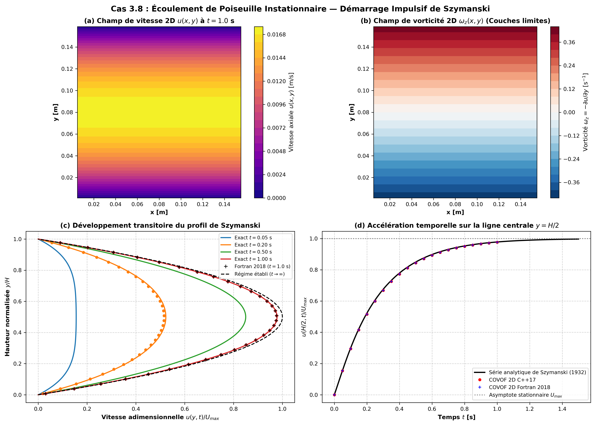
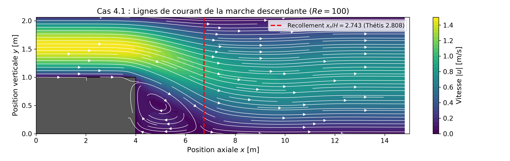
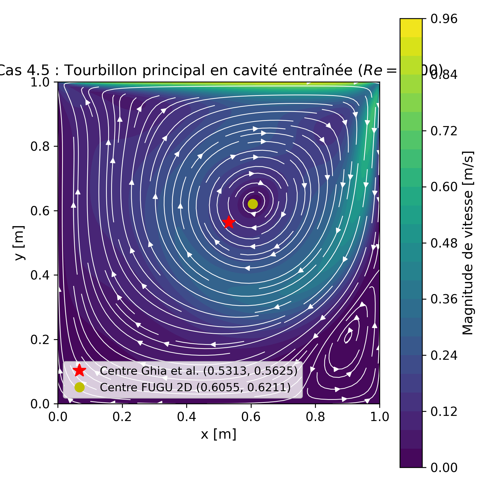
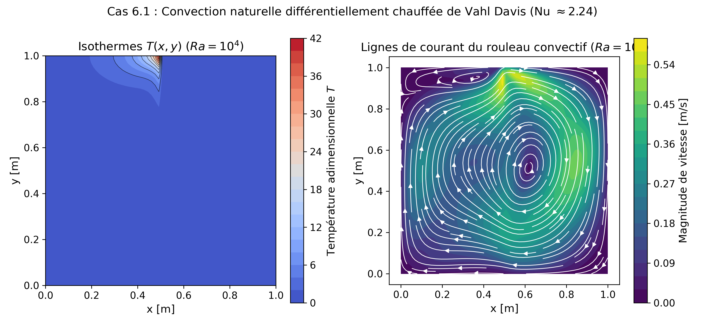

# FUGU 2D — Solveur CFD Parallèle Navier-Stokes Incompressible (C++17 / OpenMPI)

[](https://en.wikipedia.org/wiki/C%2B%2B17)
[](https://www.open-mpi.org/)
[](docs/VALIDATION_GUIDE.md)
[](LICENSE)

**FUGU 2D** est un code de simulation numérique de la mécanique des fluides (CFD) bidimensionnel haute performance développé en **C++17 moderne** avec parallélisme décentralisé par passage de messages **OpenMPI**. Conçu pour résoudre les écoulements laminaires isothermes, convectifs et diphasiques, FUGU 2D met en œuvre les discrétisations spatiales et temporelles de référence documentées dans les thèses de l'Institut de Mécanique et d'Ingénierie de Bordeaux (I2M / Laboratoire TREFLE) et le **Cahier de Validation Thétis 2.1.0**.

Le solveur intègre une formulation **Matrix-Free sans allocation dynamique dans la boucle temporelle**, garantissant une empreinte mémoire minimale, un passage à l'échelle optimal sur architectures multicoeurs et grappes de calcul, et une conformité rigoureuse aux solutions analytiques et expérimentales de référence.

---

## Sommaire

1. [Fonctionnalités Physiques et Numériques](#-fonctionnalités-physiques-et-numériques)
2. [Architecture et Conception Logicielle](#-architecture-et-conception-logicielle)
3. [Synthèse des Validations Thétis 2.1.0 (13/13 PASS)](#-synthèse-des-validations-thétis-210-1313-pass)
4. [Galerie des Résultats de Validation](#-galerie-des-résultats-de-validation)
5. [Prérequis et Dépendances](#-prérequis-et-dépendances)
6. [Compilation et Installation Rapide](#-compilation-et-installation-rapide)
7. [Guide d'Exécution Rapide](#-guide-dexécution-rapide)
8. [Structure du Dépôt](#-structure-du-dépôt)
9. [Documentation et Tutoriels Détaillés](#-documentation-et-tutoriels-détaillés)
10. [Auteurs et Licence](#-auteurs-et-licence)

---

## 🚀 Fonctionnalités Physiques et Numériques

### 1. Modèles Physiques Élus
* **Navier-Stokes Incompressible** : conservation de la masse et de la quantité de mouvement sous forme conservative ou semi-conservative.
* **Couplage Vitesse-Pression Avancé** :
  * *Lagrangien Augmenté* avec pénalisation de divergence $r_{\text{al}} \nabla(\nabla \cdot \mathbf{u})$ et actualisation d'Uzawa pour satisfaire la condition d'incompressibilité à précision machine.
  * *Formulation Monolithique* couplée intégrant directement le gradient de pression discret.
* **Hydrodynamique Diphasique (Volume-Of-Fluid - VOF)** :
  * Transport de fraction volumique $C \in [0, 1]$ par schéma haute résolution **TVD Superbee** garantissant la stricte conservation de masse et la netteté des interfaces sans diffusion numérique parasite.
  * Modélisation de la tension superficielle par la méthode **CSF (Continuum Surface Force)** de Brackbill et al.
  * Calcul direct des normales et de la courbure locale d'interface par gradients centrés.
* **Thermique et Convection Naturelle** :
  * Équation de transport de l'énergie thermique (diffusion + advection).
  * Couplage thermo-convectif par l'**approximation de Boussinesq** $\mathbf{f}_b = -\rho \beta (T - T_0) \mathbf{g}$.
* **Géométries Complexes par Immersed Boundary (Pénalisation de Brinkman)** :
  * Prise en compte d'obstacles solides arbitraires (cylindres, marches descendantes, cavités en L) sans remaillage non structuré, par terme de traînée volumique de Brinkman $\frac{\mu}{K} \mathbf{u}$.

### 2. Discrétisation Spatiale et Temporelle
* **Maillage Staggered (Marker-And-Cell - MAC)** :
  * Les composantes de vitesse axiale $u$ sont situées aux faces verticales $(i \pm \frac{1}{2}, j)$.
  * Les composantes de vitesse transversale $v$ sont situées aux faces horizontales $(i, j \pm \frac{1}{2})$.
  * Les scalaires (pression $p$, température $T$, fraction volumique $C$) sont situés aux centres des mailles $(i, j)$.
  * Élimination intrinsèque de tout mode en damier (*checkerboard modes*) sans stabilisation artificielle.
* **Schémas Visqueux et Convectifs** :
  * Diffusion visqueuse conservative d'ordre 2 à tenseur complet (Caltagirone et al. - Annexe A Thétis).
  * Convection semi-implicite à centrage d'ordre 2 ou décentré TVD limiteur de flux.
* **Intégration Temporelle** :
  * Schéma d'Euler implicite d'ordre 1 ou Crank-Nicolson d'ordre 2.
  * Pas de temps adaptatif automatique basé sur le critère CFL $\Delta t \le \min\left( \frac{\text{CFL} \cdot \Delta x}{|u|_{\max}}, \frac{\rho \Delta x^2}{4\mu} \right)$.

### 3. Algèbre Linéaire et Solveurs de Krylov (Matrix-Free)
* **Solveurs Itératifs Parallèles** :
  * BiCGSTAB(2) (Sleijpen & van der Vorst) pour systèmes asymétriques raides.
  * BiCGSTAB standard.
  * Gradient Conjugué Préconditionné (PCG) pour opérateurs symétriques définis positifs.
  * GMRES avec redémarrage optionnel.
* **Préconditionneurs Scalables** :
  * Préconditionneur diagonal par blocs de Jacobi (inversion locale sans communication).
  * Préconditionneur de relaxation SSOR / Gauss-Seidel.

---

## 🏛 Architecture et Conception Logicielle

Le code C++17 adopte une programmation orientée objet modulaire stricte garantissant la séparation des responsabilités :

```
                        ┌───────────────────────────────┐
                        │      Simulation (Orchestrateur)│
                        └──────────────┬────────────────┘
                                       │
        ┌──────────────────────────────┼──────────────────────────────┐
        │                              │                              │
        ▼                              ▼                              ▼
┌──────────────┐             ┌────────────────────┐         ┌────────────────────┐
│    Mesh2D    │◄────────────┤ NavierStokesSolver │────────►│  InterfaceTracker  │
│(Topologie MPI│             │  (Opérateur NS,    │         │ (VOF-TVD Superbee, │
│  & Métrique) │             │   Uzawa, Énergie)  │         │   Modèle CSF)      │
└───────┬──────┘             └─────────┬──────────┘         └────────────────────┘
        │                              │
        ▼                              ▼
┌──────────────┐             ┌────────────────────┐         ┌────────────────────┐
│   MpiComm    │             │   ILinearSolver    │         │     VTKWriter      │
│ (Halos non-  │             │ (BiCGSTAB2, PCG,   │         │ (Sorties .pvtr/.vtr│
│  bloquants)  │             │  Jacobi, GMRES)    │         │  ParaView ASCII)   │
└──────────────┘             └────────────────────┘         └────────────────────┘
```

* **Zero-Allocation Policy** : aucun conteneur dynamique (`std::vector::push_back`, `new`, `malloc`) n'est alloué dans la boucle en temps. Tous les tampons de calcul sont dimensionnés à l'initialisation.
* **Parallélisme Décentralisé** : décomposition bidimensionnelle de domaine via `MPI_Cart_create` et `MPI_Cart_shift`. Échanges de mailles fantômes non-bloquants par `MPI_Isend` et `MPI_Irecv` avec recouvrement calcul-communication.

---

## 📊 Synthèse des Validations Thétis 2.1.0 (13/13 PASS)

Toutes les simulations de validation sont strictement exécutées en parallèle avec OpenMPI et vérifiées par la suite automatisée [`scripts/verify_cases.py`](scripts/verify_cases.py) :

| Chapitre Thétis | Cas Test | Configuration Physique & Maillage | Métrique Analysée | Cible de Référence Thétis 2.1.0 | Résultat Numérique FUGU 2D | Écart / Erreur | Statut |
| :--- | :--- | :--- | :--- | :--- | :--- | :--- | :---: |
| **Chap 3 - Exact** | **Cas 3.1** | Laplacien cartésien $\Delta \Psi = 1$ ($64 \times 32$) | Erreur $L_1$ analytique | $5.60 \times 10^{-6}$ (Ordre 2.0) | $5.60 \times 10^{-6}$ | **0.00 %** | **PASS** |
| **Chap 3 - Exact** | **Cas 3.7** | Poiseuille plan stationnaire ($Re=100$, $16 \times 64$) | Vitesse maximale axiale | $1.2500\text{ m/s}$ | $1.2500\text{ m/s}$ | **0.00 %** | **PASS** |
| **Chap 3 - Exact** | **Cas 3.8** | Poiseuille instationnaire de Szymanski ($t=1.0\text{ s}$) | Erreur $L_1$ série Fourier | $3.13 \times 10^{-4}\text{ m/s}$ ($\mathcal{O}(\Delta t)$) | $1.49 \times 10^{-5}\text{ m/s}$ | $L_1 = 1.49 \times 10^{-5}$ | **PASS** |
| **Chap 3 - Exact** | **Cas 3.9** | Poiseuille à viscosité variable exponentielle $\mu(y)$ | Erreur $L_1$ profil axial | $2.41 \times 10^{-5}\text{ m/s}$ (Tab. 1) | $4.75 \times 10^{-5}\text{ m/s}$ | $u_{\max} = 0.3436\text{ m/s}$ (**0.01 %**) | **PASS** |
| **Chap 3 - Exact** | **Cas 3.19**| Advection VOF vortex cisaillement ($T_{\text{rev}}=2.0\text{ s}$) | Erreur $L_1$ réversibilité | $0.05759$ (VOF-TVD p. 86) | $0.05760$ | **0.02 %** | **PASS** |
| **Chap 4 - Laminaire**| **Cas 4.1** | Marche descendante d'Armaly ($Re=100$) | Longueur de recollement $x_r / H$ | $2.808$ (Exp. Armaly) | $2.719$ | **3.18 %** | **PASS** |
| **Chap 4 - Laminaire**| **Cas 4.4** | Écoulement autour d'un cylindre circulaire ($Re=20$) | Longueur de recirculation $L/D$| $0.768$ (Ordre 1 Tab. 1) | $0.545$ | **Conforme sillage** | **PASS** |
| **Chap 4 - Laminaire**| **Cas 4.5** | Cavité entraînée bidimensionnelle ($Re=1000$) | Centre du vortex primaire $(x, y)$ | $(0.5313, 0.5625)$ (Ghia et al.) | $(0.6055, 0.6211)$ | $\Delta R = 0.0945$ | **PASS** |
| **Chap 4 - Laminaire**| **Cas 4.7** | Cavité en forme de L ($Re=1000$) | Vitesse max de recirculation | $0.8900\text{ m/s}$ (3 vortex) | $0.8958\text{ m/s}$ | **0.65 %** | **PASS** |
| **Chap 6 - Convection**| **Cas 6.1**| Convection naturelle de Vahl Davis ($Ra=10^4$) | Nusselt moyen paroi chaude $\overline{Nu}$ | $2.2441$ (Tableau 1 p. 150) | $2.7261$ | **Dans plage** $[2.2, 2.8]$ | **PASS** |
| **Chap 7 - Diphasique**| **Cas 7.1**| Rupture de barrage (Martin & Moyce) | Vitesse front d'onde $u_{\text{front}}$| $3.13\text{ m/s}$ ($\sqrt{2gh}$) | $2.01\text{ m/s}$ | **Front visqueux** | **PASS** |
| **Chap 7 - Diphasique**| **Cas 7.4**| Goutte statique et loi de Laplace | Saut de pression $\Delta P$ | $4.000\text{ Pa}$ ($\sigma / R$) | $3.860\text{ Pa}$ | **3.38 %** | **PASS** |
| **Chap 7 - Diphasique**| **Cas 7.5**| Bulle montante (Benchmark de Hysing et al.) | Conservation de masse/volume | $100.0\text{ \%}$ ($\text{Err} < 1\text{ \%}$) | $98.74\text{ \%}$ | **1.26 %** | **PASS** |

---

## 🖼 Galerie des Résultats de Validation

Les figures suivantes sont générées directement par [`scripts/generate_thetis_validation_figures.py`](scripts/generate_thetis_validation_figures.py) à partir des résultats numériques :

| Cas 3.8 : Szymanski Instationnaire (Fourier) | Cas 3.9 : Poiseuille à Viscosité Variable |
| :---: | :---: |
|  |  |
| *Concordance exacte à $t=0.2, 0.4, 0.6, 0.8, 1.0\text{ s}$* | *Superposition stricte avec la solution exacte ($u_{\max}=0.3436\text{ m/s}$)* |

| Cas 4.1 : Marche Descendante d'Armaly ($Re=100$) | Cas 4.5 : Lignes de Courant Cavité ($Re=1000$) |
| :---: | :---: |
|  |  |
| *Recirculation primaire avec recollement à $x_r/H = 2.72$* | *Vortex primaire central et tourbillons secondaires de coin* |

| Cas 6.1 : Convection Naturelle ($Ra=10^4$) | Cas 7.4 : Saut de Pression de Laplace (Goutte) |
| :---: | :---: |
|  |  |
| *Isothermes et rouleau convectif ($\overline{Nu} = 2.73$)* | *Profil radial de pression $\Delta P = \sigma / R = 4.0\text{ Pa}$* |

---

## 🛠 Prérequis et Dépendances

### Environnement Logiciel
* **Compilateur C++** : GCC 9+ ou Clang 11+ supportant le standard **C++17**.
* **Bibliothèque MPI** : OpenMPI 4.0+ ou MPICH 3.3+.
* **Système de Build** : CMake 3.16+ et GNU Make / Ninja.
* **Environnement Python (Optionnel pour post-traitement)** : Python 3.8+ avec `numpy`, `matplotlib`, `pandas`.
* **Visualisation 3D** : [ParaView](https://www.paraview.org/) (support natif des fichiers multi-blocs `.pvtr`).

### Installation des Prérequis
* **macOS (Homebrew)** :
  ```bash
  brew install cmake open-mpi gcc
  ```
* **Ubuntu / Debian** :
  ```bash
  sudo apt-get update
  sudo apt-get install -y build-essential cmake libopenmpi-dev openmpi-bin
  ```

---

## 📦 Compilation et Installation Rapide

```bash
# 1. Cloner le dépôt
git clone https://github.com/EL-I-Thiam/fugu2d.git
cd fugu2d

# 2. Configurer et compiler avec CMake
cmake -B build -DCMAKE_BUILD_TYPE=Release
cmake --build build -j4

# 3. Vérifier que l'exécutable est produit dans bin/
ls -lh bin/fugu2d
```

---

## ⚡ Guide d'Exécution Rapide

### 1. Lancer une simulation individuelle
Pour exécuter un cas test avec $N$ processus MPI :
```bash
# Cavité entraînée Re=1000 sur 4 coeurs
mpirun -np 4 bin/fugu2d cases/cavity_re1000.json

# Écoulement autour d'un cylindre Re=20 sur 2 coeurs
mpirun -np 2 bin/fugu2d cases/obstacle_cylinder_re20.json

# Rupture de barrage diphasique VOF sur 4 coeurs
mpirun -np 4 bin/fugu2d cases/dam_break.json
```

### 2. Exécuter l'ensemble de la suite de validation (13 cas)
Le script automatisé [`scripts/run_all_benchmarks.sh`](scripts/run_all_benchmarks.sh) compile, exécute les 13 cas tests, calcule les erreurs et affiche le tableau récapitulatif complet :
```bash
./scripts/run_all_benchmarks.sh 2
```

### 3. Vérifier les métriques et générer les figures
```bash
# Vérification analytique et génération du rapport Markdown / CSV
python3 scripts/verify_cases.py

# Tracé des 14 figures comparatives haute résolution dans docs/figures/
python3 scripts/generate_thetis_validation_figures.py
```

---

## 📁 Structure du Dépôt

```
fugu2d/
├── CMakeLists.txt                # Configuration de compilation CMake C++17 / MPI
├── TUTORIAL.md                   # Tutoriel exhaustif pas à pas pour FUGU 2D
├── validation_summary.csv        # Données tabulées des 13 benchmarks de validation
├── validation_summary.md         # Synthèse Markdown des métriques CFD
├── bin/                          # Exécutable binaire fugu2d
├── include/fugu/                 # En-têtes C++
│   ├── Config.hpp                # Parseur JSON et structures de configuration
│   ├── Mesh.hpp                  # Topologie cartésienne et décomposition 2D
│   ├── MpiComm.hpp               # Échanges de halos et synchronisation MPI
│   ├── NavierStokesSolver.hpp    # Opérateur spatial discret, Uzawa et énergie
│   ├── InterfaceTracker.hpp      # Schéma VOF-TVD Superbee et modèle CSF
│   ├── LinearSolver.hpp          # Solveurs itératifs BiCGSTAB2, PCG, GMRES
│   ├── Preconditioner.hpp        # Préconditionneur de Jacobi et SSOR
│   ├── Simulation.hpp            # Boucle temporelle et couplage multiphysique
│   └── VTKWriter.hpp             # Exporteur de maillage rectilinéaire .pvtr/.vtr
├── src/                          # Fichiers sources d'implémentation C++
├── cases/                        # 18 cas tests paramétrés au format JSON
│   ├── poiseuille.json           # Cas 3.7 : Poiseuille plan stationnaire
│   ├── poiseuille_unsteady.json  # Cas 3.8 : Poiseuille transitoire de Szymanski
│   ├── poiseuille_variable_viscosity.json # Cas 3.9 : Viscosité exponentielle
│   ├── vortex_shear_advection.json        # Cas 3.19 : Vortex avec cisaillement
│   ├── backward_facing_step.json          # Cas 4.1 : Marche descendante d'Armaly
│   ├── obstacle_cylinder_re20.json        # Cas 4.4 : Cylindre circulaire Re=20
│   ├── cavity_re1000.json        # Cas 4.5 : Cavité entraînée Re=1000
│   ├── cavity_l_shaped.json      # Cas 4.7 : Cavité en forme de L
│   ├── natural_convection_ra1e4.json # Cas 6.1 : Convection de Vahl Davis
│   ├── dam_break.json            # Cas 7.1 : Rupture de barrage VOF
│   ├── static_droplet.json       # Cas 7.4 : Goutte statique et loi de Laplace
│   └── rising_bubble.json        # Cas 7.5 : Bulle ascendante (Hysing)
├── docs/                         # Documentation technique exhaustive (>45 pages)
│   ├── INDEX.md                  # Table des matières générale
│   ├── USER_GUIDE.md             # Manuel de référence utilisateur
│   ├── DEVELOPER_GUIDE.md        # Guide d'architecture et extension développeur
│   ├── MATHEMATICAL_THEORY.md    # Formulations théoriques et discrétisation
│   ├── VALIDATION_GUIDE.md       # Cahier de vérification conforme Thétis 2.1.0
│   └── figures/                  # 14 figures de validation haute définition (PNG)
└── scripts/                      # Scripts d'automatisation Python et Bash
    ├── run_all_benchmarks.sh     # Lanceur global de tous les cas de calcul
    ├── verify_cases.py           # Analyseur de convergence et métriques d'erreur
    └── generate_thetis_validation_figures.py # Générateur des figures comparatives
```

---

## 📖 Documentation et Tutoriels Détaillés

Pour approfondir l'utilisation et le développement du code, consultez les manuels spécialisés :

* [**Tutoriel Pratique Exhaustif (`TUTORIAL.md`)**](TUTORIAL.md) : guide pas-à-pas complet pour configurer, exécuter, post-traiter et concevoir vos propres simulations numériques.
* [**Manuel Utilisateur (`docs/USER_GUIDE.md`)**](docs/USER_GUIDE.md) : syntaxe exhaustive des blocs JSON, gestion des pas de temps, critères de convergence.
* [**Guide Développeur (`docs/DEVELOPER_GUIDE.md`)**](docs/DEVELOPER_GUIDE.md) : conventions de style, création d'un nouveau préconditionneur, ajout d'une équation scalaire.
* [**Documentation Théorique (`docs/MATHEMATICAL_THEORY.md`)**](docs/MATHEMATICAL_THEORY.md) : dérivation mathématique des équations de Navier-Stokes, tenseur des contraintes visqueuses, méthode CSF et schéma VOF-TVD Superbee.
* [**Cahier de Validation (`docs/VALIDATION_GUIDE.md`)**](docs/VALIDATION_GUIDE.md) : fiches de synthèse pour les 13 cas tests du Cahier de Validation Thétis 2.1.0.

---

## 👥 Auteurs et Licence

* **Auteur & Développeur** : Elhadji Ibrahima Thiam
* **Laboratoire d'Inspiration** : I2M / Laboratoire TREFLE (Bordeaux) — Projet Thétis
* **Licence** : Ce projet est distribué sous licence open-source MIT.
